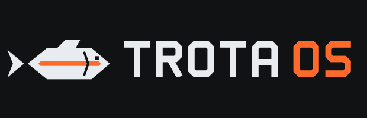

# Identità visiva

L'identità di Trota OS è **industriale, tecnica e minimale**: superfici scure
come metallo lavorato, linee nette, un solo colore d'accento.



## Il simbolo

Una trota stilizzata costruita solo con segmenti retti, come un pezzo
lavorato a macchina:

- corpo esagonale allungato, coda biforcuta separata dal corpo, pinna dorsale;
- la **banda arancione** è la linea laterale della trota iridea ed è l'unico
  elemento colorato;
- occhio e branchia sono *ritagli* reali (maschere), quindi il simbolo
  funziona su qualunque sfondo.

Il wordmark **TROTA OS** è disegnato con tratti di spessore costante e angoli
smussati a 45°, senza dipendere da un font installato: "OS" è in arancione.

## Palette

| Nome | Esadecimale | Uso |
|---|---|---|
| Nero carbone | `#101214` | Sfondi principali, testo su fondo chiaro |
| Grafite | `#191D21` | Superfici, pannelli, dock |
| Grigio acciaio | `#737B84` | Linee tecniche, testo secondario |
| Bianco freddo | `#E8ECEF` | Testo e simbolo su fondo scuro |
| Arancione industriale | `#FF6A2A` | **Solo accento**: banda del logo, "OS", indicatori, pulsante principale |

L'arancione su fondo chiaro ha un contrasto di circa 2,4–2,9:1 (bianco freddo – bianco): va usato per
elementi grafici e testo grande, non per testo normale.

## Varianti del logo (`branding/logo/`)

| File | Uso |
|---|---|
| `trota-logo-dark.svg` | Orizzontale, per fondi scuri (predefinito) |
| `trota-logo-light.svg` | Orizzontale, per fondi chiari |
| `trota-logo-stacked-*.svg` | Verticale (splash, copertine) |
| `trota-logo-mono-black.svg` / `-white.svg` | Monocromatico (stampa, incisione, timbri) |
| `trota-symbol*.svg` | Solo simbolo (icone, favicon, avatar) |
| `trota-wordmark-*.svg` | Solo scritta |

Area di rispetto: almeno l'altezza della pinna dorsale su ogni lato. Non
deformare, ruotare, ricolorare con colori fuori palette o aggiungere effetti.

## Dove compare

| Contesto | Asset |
|---|---|
| Avvio (Plymouth) | `trota-logo-dark` + indicatore a segmenti arancione + barra di avanzamento |
| Menu di avvio della ISO (GRUB) | `themes/grub/trota/background.svg` |
| Schermata di login (GDM) | `trota-logo-gdm.png` (logo orizzontale, 64 px) |
| Desktop | Sfondi *Forge* (scuro), *Steel* (chiaro), *Ingot* |
| Applicazioni | Icone `it.testardstudios.*`: piastrella grafite, glifo bianco, accento arancione |
| Terminale | Profilo "Trota": fondo carbone, cursore arancione, palette a 16 colori |
| Documentazione | Intestazione carbone con filo arancione |

## Rigenerare gli asset

Tutti gli SVG sono prodotti da `branding/generate.py` partendo da un'unica
geometria; non vanno modificati a mano.

```sh
python3 branding/generate.py          # riscrive gli SVG
python3 branding/generate.py --check  # verifica (usato dai test)
sh branding/render.sh /tmp/out        # PNG per pacchetti e documentazione
```
